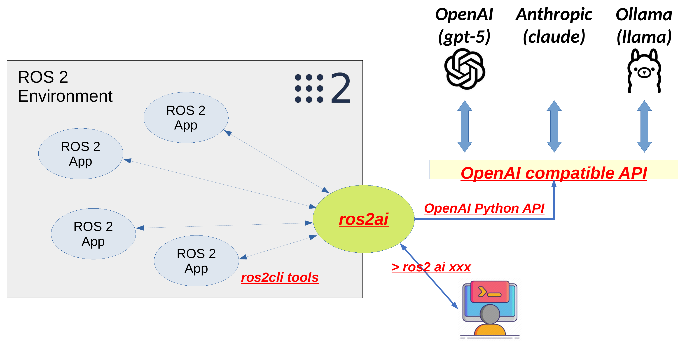

[](https://github.com/fujitatomoya/ros2ai/actions/workflows/humble.yml) [](https://github.com/fujitatomoya/ros2ai/actions/workflows/jazzy.yml) [](https://github.com/fujitatomoya/ros2ai/actions/workflows/kilted.yml) [](https://github.com/fujitatomoya/ros2ai/actions/workflows/lyrical.yml) [](https://github.com/fujitatomoya/ros2ai/actions/workflows/rolling.yml)
[](https://github.com/fujitatomoya/ros2ai/actions/workflows/humble-nightly.yml) [](https://github.com/fujitatomoya/ros2ai/actions/workflows/jazzy-nightly.yml) [](https://github.com/fujitatomoya/ros2ai/actions/workflows/kilted-nightly.yml) [](https://github.com/fujitatomoya/ros2ai/actions/workflows/lyrical-nightly.yml) [](https://github.com/fujitatomoya/ros2ai/actions/workflows/rolling-nightly.yml)

# ros2ai 🤖

[ros2ai](https://github.com/fujitatomoya/ros2ai) is a <span style="color:red">next-generation</span> [ROS 2](https://github.com/ros2) command line interface extension with [OpenAI](https://openai.com/), [Anthropic](https://www.anthropic.com/) and [Ollama](https://github.com/ollama/ollama).

see [overview slide deck](https://raw.githack.com/fujitatomoya/ros2ai/rolling/doc/overview.html) for more information.



## Motivation

- (Just for fun 😝)
- Getting answers against the questions directly without browsing, clicking and typing many times.
- Easy to use for everyone, especially for [ROS 2](https://github.com/ros2) beginners and students who do not really know [ros2cli](https://github.com/ros2/ros2cli).
- Multiple language support.
- Multiple LLMs support (with [OpenAI Python API](https://github.com/openai/openai-python), any OpenAI compatible endpoint such as [Anthropic](https://platform.claude.com/docs/en/api/openai-sdk) and [Ollama](https://github.com/ollama/ollama))

## Demo 🖥️

See how it works 🔥

https://github.com/fujitatomoya/ros2ai/assets/43395114/78a0799b-40e3-4dc8-99cb-488994e94769

## Supported [ROS Distribution](https://docs.ros.org/en/rolling/Releases.html)

| Distribution      | Supported | Note |
| :---------------- | :-------- | :--- |
| Rolling Ridley    |    ✅     | Development / Mainstream Branch |
| Lyrical Luth      |    ✅     | |
| Kilted Kaiju      |    ✅     | |
| Jazzy Jalisco     |    ✅     | |
| Humble Hawksbill  |    ✅     | |

## Installation

### Binary

```bash
apt install ros-kilted-ros2ai
```

### Docker Container

see available images for [tomoyafujita/ros2ai@dockerhub](https://hub.docker.com/repository/docker/tomoyafujita/ros2ai/tags?page=1&ordering=last_updated)

```bash
docker run -it --rm --net=host -e ROS2AI_API_KEY=$ROS2AI_API_KEY -e ROS2AI_ENDPOINT=$ROS2AI_ENDPOINT -e ROS2AI_MODEL_NAME=$ROS2AI_MODEL_NAME tomoyafujita/ros2ai:rolling
```

> [!NOTE]
> `ROS2AI_API_KEY` environmental variable is not required if using Ollama. And it is expecting that Ollama runs on the host system mostly, so that container is bound to the host network interface.

https://github.com/fujitatomoya/ros2ai/assets/43395114/2af4fd44-2ccf-472c-9153-c3c19987dc96

### Required Package

- `rolling` / `lyrical` / `kilted` / `jazzy`

  ```bash
  pip install openai ollama validators --break-system-packages --ignore-installed
  ```

  > [!NOTE]
  > see [PEP 668 – Marking Python base environments as “externally managed”](PEP 668 – Marking Python base environments as “externally managed”) why `--break-system-packages` is required.

- `humble`

  ```bash
  pip install openai ollama validators --ignore-installed
  ```

### Build

No released package is available, needs to be build in colcon workspace.

```bash
source /opt/ros/rolling/setup.bash
mkdir -p colcon_ws/src
cd colcon_ws/src
git clone https://github.com/fujitatomoya/ros2ai.git
cd ..
colcon build --symlink-install --packages-select ros2ai
```

## Usage

### Prerequisites

As described in overview diagram, `ros2ai` uses only OpenAI Python API but backend implementation can be replaced with any LLM service that provides the compatible API with OpenAI, such as Anthropic and Ollama.
User need to choose which of them is used by `ros2ai` as following configuration, otherwise it falls back to use OpenAI.

- [OpenAI](https://openai.com/)

  `ros2ai` requires [OpenAI API key](https://platform.openai.com/docs/overview)

  ```bash
  export ROS2AI_API_KEY='your-api-key-here'
  ```

  > [!CAUTION]
  > Do not share or expose your OpenAI API key.

- [Anthropic](https://www.anthropic.com/)

  `ros2ai` requires [Anthropic API key](https://platform.claude.com/settings/keys), the API is accessed via [OpenAI SDK compatibility](https://platform.claude.com/docs/en/api/openai-sdk).

  ```bash
  export ROS2AI_API_KEY='your-api-key-here'
  export ROS2AI_ENDPOINT=https://api.anthropic.com/v1/
  export ROS2AI_MODEL_NAME=claude-opus-5-5
  ```

  > [!CAUTION]
  > Do not share or expose your Anthropic API key.

  > [!NOTE]
  > Anthropic accepts the temperature between 0.0 and 1.0 only, the `ros2ai` default (1.0) works with every Claude model.

- [Ollama](https://github.com/ollama/ollama)

  `ros2ai` requires [Ollama](https://github.com/ollama/ollama) service running, see more details for [How to install Ollama to Linux](https://github.com/ollama/ollama/blob/main/docs/linux.md)

  ```bash
  ### Install Ollama and System Service
  sudo curl -fsSL https://ollama.com/install.sh | sh
  ### Check ollama.service is up and running
  systemctl status ollama
  ### Pull llama3.1 (for example) model
  ollama pull llama3.1
  ### List available models
  ollama list
  ```

#### Optional

| environmental variable | default                     | Note                   |
| :----------------------| :-------------------------- | :--------------------- |
| ROS2AI_API_KEY         | None.                       | Required for OpenAI and Anthropic |
| ROS2AI_MODEL_NAME      | 'gpt-5'                     | AI model to be used. e.g) claude-opus-5-5 (Anthropic), llama3.1 (Ollama) |
| ROS2AI_ENDPOINT        | 'https://api.openai.com/v1' | API endpoint URL. e.g) https://api.anthropic.com/v1/ (Anthropic), http://127.0.0.1:11434/v1 (Ollama) |
| ROS2AI_TEMPERATURE     | 1.0                         | [OpenAI temperature](https://platform.openai.com/docs/guides/text-generation/how-should-i-set-the-temperature-parameter), 0.0 - 1.0 for Anthropic |
| ROS2AI_ROLE_SYSTEM     | built-in system role        | System role for the prompt, `{}` is replaced with the ROS distribution name |
| ROS2AI_CONTEXT_LIMIT   | 16000                       | Context limit of the session in estimated tokens, the oldest requests are dropped beyond it. Lower it for the local models with a small context window (e.g Ollama `num_ctx`) |
| ROS2AI_SESSION_FILE    | `~/.local/state/ros2ai/session.json` | Session file to continue the previous requests with `--continue` (`$XDG_STATE_HOME` is honored) |

> [!NOTE]
> These are optional environmental variables. if not set, default value will be used.
> The legacy `OPENAI_API_KEY`, `OPENAI_MODEL_NAME`, `OPENAI_ENDPOINT`, `OPENAI_TEMPERATURE` and `OPENAI_ROLE_SYSTEM` are still honored when the corresponding `ROS2AI_*` variable is not set.

### Examples

#### Basics

`ros2 ai` has no sub-command, just pass your question or request: `ros2 ai "<request>"`.
The ROS 2 assistant decides by itself whether to answer the question or to operate the ROS 2 system on your behalf.

- configuration

  ```bash
  ### OpenAI configuration
  export ROS2AI_API_KEY=<YOUR_API_KEY>
  export ROS2AI_MODEL_NAME=gpt-5
  export ROS2AI_ENDPOINT=https://api.openai.com/v1

  ### Anthropic configuration
  export ROS2AI_API_KEY=<YOUR_API_KEY>
  export ROS2AI_MODEL_NAME=claude-opus-5-5
  export ROS2AI_ENDPOINT=https://api.anthropic.com/v1/

  ### Ollama
  unset ROS2AI_API_KEY
  export ROS2AI_MODEL_NAME=llama3.1
  export ROS2AI_ENDPOINT=http://127.0.0.1:11434/v1
  ```

- `--status` (`-s`) to check API key and configuration are valid, `--list-models` (`-l`) prints the available models.

  ```bash
  root@tomoyafujita:~/docker_ws/ros2_colcon# ros2 ai -s -v
  ----- api_model: gpt-5
  ----- api_endpoint: https://api.openai.com/v1
  ----- api_token: None
  ----- api_temperature: 1.0
  As an artificial intelligence, I do not have a physical presence, so I can't be "in service" in the traditional sense. But I am available to assist you 24/7.
  [SUCCESS] Valid API key.
  [SUCCESS] Retrieved list of models.
  ```

- ask any questions to ROS 2 assistant.

  ```bash
  root@tomoyafujita:~/docker_ws/ros2_colcon# ros2 ai "Tell me how to check the available topics?"
  To check the available topics in ROS 2, you can use the following command in the terminal:

  ---
  ros2 topic list
  ---

  After you enter this command, a list of all currently active topics in your ROS2 system will be displayed. This list includes all topics that nodes in your system are currently publishing to or subscribing from.
  ```

- request ROS 2 assistant to operate the ROS 2 system.

  The assistant calls the [ros2cli](https://github.com/ros2/ros2cli) tools (`ros2 node`, `ros2 topic`, `ros2 service`, `ros2 param` and so on) via [tool calling](https://platform.openai.com/docs/guides/function-calling), observes the result and iterates until the request is done.
  Every command is printed before it is executed, and executed without shell, so that the model can only run `ros2` commands.

  | Tool policy  | Commands                                                        | Behavior |
  | :----------- | :-------------------------------------------------------------- | :------- |
  | read-only    | `node`, `topic list/info/echo`, `service list`, `param get` ... | executed automatically |
  | mutating     | `topic pub`, `service call`, `param set`, `action send_goal` ...| asks for confirmation, `-y` / `--yes` skips it |
  | long-running | `run`, `launch`, `bag record` ...                               | asks for confirmation, runs in foreground until `Ctrl-C` |

  ```bash
  root@tomoyafujita:~/docker_ws/ros2_colcon# ros2 ai "give me all topics"
  [ros2ai]: ros2 topic list -t
  /chatter [std_msgs/msg/String]
  /parameter_events [rcl_interfaces/msg/ParameterEvent]
  /rosout [rcl_interfaces/msg/Log]
  Here are all the available topics in your ROS 2 system:
  | Topic | Message Type |
  |-------|-------------|
  | `/chatter` | `std_msgs/msg/String` |
  | `/parameter_events` | `rcl_interfaces/msg/ParameterEvent` |
  | `/rosout` | `rcl_interfaces/msg/Log` |
  That's 3 topics in total. Let me know if you'd like to inspect any of them further (e.g., see publishers/subscribers, echo a message, or publish to one).
  root@tomoyafujita:~/docker_ws/ros2_colcon# ros2 ai "publish hello message on /chatter topic" -y
  [ros2ai]: ros2 topic info -v /chatter
  Type: std_msgs/msg/String
  ...
  Subscription count: 0
  [ros2ai]: ros2 topic pub --once -w 0 /chatter std_msgs/msg/String '{data: hello}'
  publisher: beginning loop
  publishing #1: std_msgs.msg.String(data='hello')
  Done — I published the message `hello` on `/chatter` (`std_msgs/msg/String`). Note: the topic currently shows 0 subscribers, so no node received it. Let me know if you want me to start a listener (e.g., `demo_nodes_cpp`'s `listener`) first.
  ```

  Without `-y`, the assistant asks `Execute 'ros2 topic pub --once -w 0 /chatter std_msgs/msg/String '{data: hello}''? [y/N]:` before publishing.

  `--dry-run` prints the commands that change the system as candidates instead of executing them (read-only commands are still executed, so that the assistant can decide the command), `-v` prints the system role, the tool calls and results.
  The answers are streamed as they arrive, `-n` disables the streaming (the raw completions are printed with `-nv`).

  Composite tools answer a diagnostic question with several `ros2` commands in a single tool call, instead of one completion per command.
  `get_node_status` combines `node info`, `lifecycle get`, `param list` and `topic hz` of the published topics, `get_topic_status` combines `topic info -v`, `topic hz` and `topic echo --once`.
  The commands are printed indented under the tool call, and the result is a YAML summary including the warnings found (lifecycle state not active, idle publisher, incompatible QoS and so on).

  ```bash
  root@tomoyafujita:~/docker_ws/ros2_colcon# ros2 ai "is /lc_talker healthy?"
  [ros2ai]: get_node_status(node=/lc_talker)
  [ros2ai]:   ros2 node info /lc_talker
  [ros2ai]:   ros2 lifecycle get /lc_talker
  [ros2ai]:   ros2 param list /lc_talker
  node: /lc_talker
  found: true
  lifecycle: unconfigured
  publishers:
  - topic: /lc_talker/transition_event
    type: lifecycle_msgs/msg/TransitionEvent
    hz: not measured
  subscribers: {}
  service_servers: {}
  service_clients: {}
  action_servers: {}
  action_clients: {}
  parameters:
  - use_sim_time
  warnings:
  - lifecycle state is 'unconfigured', not active
  No — `/lc_talker` is not healthy. It's a **lifecycle node stuck in the `unconfigured` state**:
  ...
  So the node exists and is alive on the graph, but it has never been transitioned to an active state. If you'd like, I can transition it to `configured` → `active` via the lifecycle services (`/lc_talker/change_state`), or list the lifecycle service details first.
  root@tomoyafujita:~/docker_ws/ros2_colcon# ros2 ai "what is the status of the /chatter topic?"
  [ros2ai]: get_topic_status(topic=/chatter)
  [ros2ai]:   ros2 topic info -v /chatter
  [ros2ai]:   ros2 topic hz /chatter
  [ros2ai]:   ros2 topic echo --once /chatter
  topic: /chatter
  found: true
  type: std_msgs/msg/String
  publishers:
  - node: /talker
    reliability: RELIABLE
    durability: VOLATILE
  subscribers:
  - node: /listener
    reliability: RELIABLE
    durability: VOLATILE
  hz: 1.0
  sample: 'data: ''Hello World: 108'''
  warnings: []
  The `/chatter` topic is healthy and active:
  ...
  Everything looks normal — the topic is being published at 1 Hz and received without issues.
  ```

  > [!NOTE]
  > If the endpoint or the model does not support tool calling, the assistant answers the request without tools, nothing is executed.

#### Session

`ros2 ai` keeps the context of the session, so that the follow-up requests can refer to the previous ones (e.g `it`).

- `ros2 ai` without a request starts the interactive session, the context is kept until the session ends with `exit` or Ctrl-D. `/clear` forgets the context, Ctrl-C aborts the request in progress.

  ```bash
  root@tomoyafujita:~/docker_ws/ros2_colcon# ros2 ai
  ros2ai interactive session (model: gpt-5, endpoint: https://api.openai.com/v1)
  Type /help for the commands, exit or Ctrl-D to end the session.
  ros2ai> do we have /chatter topic?
  [ros2ai]: ros2 topic list -t
  /chatter [std_msgs/msg/String]
  /parameter_events [rcl_interfaces/msg/ParameterEvent]
  /rosout [rcl_interfaces/msg/Log]
  Yes, the /chatter topic (std_msgs/msg/String) is available.
  ros2ai> subscribe it
  [ros2ai]: ros2 topic echo --once /chatter
  data: 'Hello World: 12'
  ---
  Subscribed to /chatter and received the message 'Hello World: 12'.
  ros2ai> exit
  ```

- `--continue` (`-c`) continues the previous session with a single request, every request is saved to the session file.

  ```bash
  root@tomoyafujita:~/docker_ws/ros2_colcon# ros2 ai "do we have /chatter topic?"
  [ros2ai]: ros2 topic list -t
  /chatter [std_msgs/msg/String]
  /parameter_events [rcl_interfaces/msg/ParameterEvent]
  /rosout [rcl_interfaces/msg/Log]
  Yes, the /chatter topic (std_msgs/msg/String) is available.
  root@tomoyafujita:~/docker_ws/ros2_colcon# ros2 ai -c "subscribe it"
  [ros2ai]: ros2 topic echo --once /chatter
  data: 'Hello World: 25'
  ---
  Subscribed to /chatter and received the message 'Hello World: 25'.
  ```

> [!NOTE]
> The messages of the previous requests are sent with every request, so the token consumption grows with the session.
> The oldest requests are dropped when the estimated number of tokens exceeds `ROS2AI_CONTEXT_LIMIT`, or when the endpoint reports that the context length is exceeded.

#### Multiple Language

- Japanese (could be any language ❓)

  ```bash
  root@tomoyafujita:~/docker_ws/ros2_colcon# ros2 ai "パラメータのリスト取得方法を教えて"
  ROS 2のパラメータリストを取得するには、コマンドラインインターフェース(CLI)を使います。具体的には、次のコマンドを使用します：

  ---code
  ros2 param list
  ---

  このコマンドは、現在動作しているすべてのノードのパラメーターをリストアップします。特定のノードのパラメータだけを見たい場合には、以下のようにノード名を指定することもできます。

  ---code
  ros2 param list /node_name
  ---

  このようにして、ROS2のパラメータリストの取得を行うことが可能です。なお、上述したコマンドはシェルから直接実行してください。
  ```

## Reference

[](https://www.youtube.com/watch?v=60IOU1KrWXY)

- [ROSCon 2024 Presentation Slide](https://raw.githack.com/fujitatomoya/ros2ai/rolling/doc/ROSCon2024_ros2ai.html)
- [OpenAI API documentation](https://platform.openai.com/docs)
- [OpenAI Python API](https://github.com/openai/openai-python)
- [Anthropic API documentation](https://platform.claude.com/docs)
- [Anthropic OpenAI SDK compatibility](https://platform.claude.com/docs/en/api/openai-sdk)
- [Ollama](https://github.com/ollama/ollama)
- [Ollama Python API](https://github.com/ollama/ollama-python)

Special thanks to [OpenAI API](https://platform.openai.com/), [Anthropic API](https://platform.claude.com/) and [Ollama](https://github.com/ollama/ollama) 🌟🌟🌟
