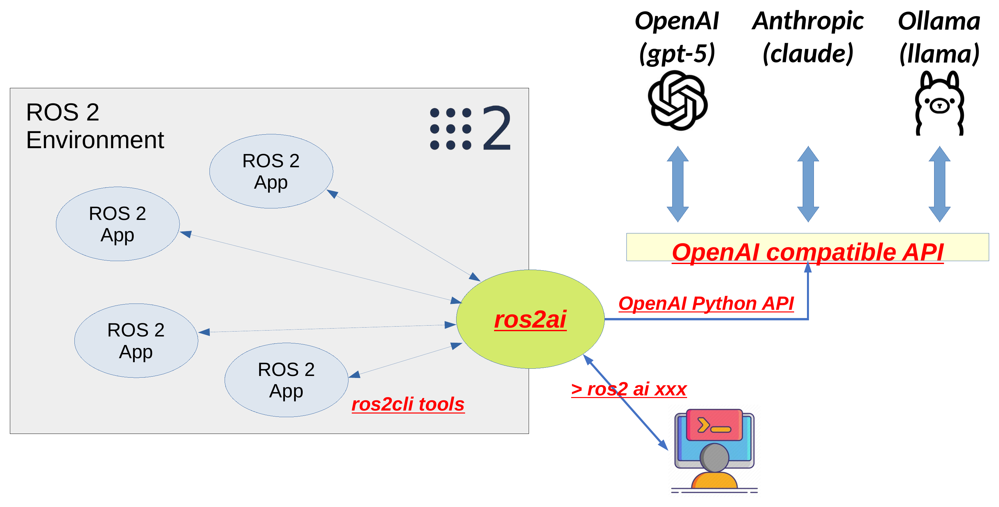

# ***ros2ai Next-Gen ROS 2 CLI***

[ros2ai](https://github.com/fujitatomoya/ros2ai) is a next-generation [ROS 2](https://github.com/ros2) command line interface extension with [OpenAI](https://openai.com/), [Anthropic](https://www.anthropic.com/) and [Ollama](https://github.com/ollama/ollama)

---

# [Everything Here!!!](https://github.com/fujitatomoya/ros2ai)

***Issues/PRs Welcome***

---

<video controls="controls" width="1000" src="./images/ros2ai_demo.mp4"></video>

---

# Motivation

- (Originally just for fun 😂)
- Get answers to questions quickly.
- Multiple Language Support.
- Support beginners and students. (your best trainer)
- Easy to use for everyone.
- Minimal dependencies, ros2cli and OpenAI Python API.
- Agnostic from LLM service (OpenAI, Anthropic, Ollama or any OpenAI compatible endpoint)

---

# Background

## I want the answers w/o searching...

browsing, clicking and typing many times to get to the information does not work for me. I need ***what***, not ***where***. all these are small things, but can easily pile up into a mountain, especially for beginners.

---

## I really do not care how to use ros2cli...

many sub-commands, options, and arguments. besides, those could be deprecated or removed from time to time... this does not work for me. actually i just want to ask "what parameters are available?", "check the details for the topic /chatter", but before that i need to know how to do that... this is already a barrier for beginners.

it would be better for maintenance if someone abstracts this to the user, so that maintainers can just go ahead to remove, change options w/o deprecation or certain soak time...

---

## Multi-Language Documentation

OSS projects tend to add multi-language support documentation under mainline doc. this is common, but the question is ***Does it really work?***... IMO, it does (will) not. eventually those docs will be outdated, not maintained, not scalable, not precise and once that happens these docs would be garbage.

i believe that is exactly where AI comes to play. instead of paying the resources to non-scalable things, focus on the mainline with precise information which is available for any languages.

---

# Design

- ***SIMPLE***. one of the original motivations, it has to be as simple as possible. That is, there is no sub-command at all, just `ros2 ai <whatever your request>`.

---

---

# Usage

- `ros2 ai "<request>"` is the only entry point, the request can be any question related to ROS 2, or the operation against the ROS 2 system. The system role has a default, and can be changed with `--role`.
- AI decides by itself whether to answer the question, or to inspect and operate the ROS 2 system via [Function Calling](https://platform.openai.com/docs/guides/function-calling) with [ros2cli](https://github.com/ros2/ros2cli) tools. The commands that change the system require the user confirmation.
- `ros2 ai --status` is to check if `ros2ai` is configured properly.
- `ros2 ai` without a request starts the interactive session, and `ros2 ai --continue "<request>"` continues the previous session, so that the follow-up requests can refer to the previous ones.

---

# Tool Calling Policy

- Every tool maps to [ros2cli](https://github.com/ros2/ros2cli), executed without shell. The commands that change the system are printed, `--trace` prints every tool call with its output.
- **read-only** (`node list/info`, `topic list/info/echo`, `param get`...) run automatically.
- **mutating** (`topic pub`, `service call`, `param set`...) require confirmation, `--yes` skips it, `--dry-run` only prints the candidates.
- **long-running** (`run`, `launch`, `bag record`...) require confirmation and run in foreground until `Ctrl-C`.
- **composite** (`get_node_status`, `get_topic_status`) run several commands in one call and return a YAML summary with warnings.

---

# Documentation Grounding

- The answers about ROS 2 concepts, tutorials, tools and APIs are grounded in the official [ROS 2 documentation](https://docs.ros.org/en/rolling/) of the running distribution (`ROS_DISTRO`), and cite the page.
- `search_ros2_docs` and `read_ros2_docs` look up the [documentation sources](https://github.com/ros2/ros2_documentation) cached locally (`~/.cache/ros2ai/docs/<distro>`), downloaded once per distribution and refreshed weekly, offline afterwards.
- Multi-language support stays on the mainline documentation, the model translates on demand.

---

# Future Work: Voice Interface

It would be really helpful to interact by voice instead of typing.
So the user can just talk to the `ros2ai` agent, and then `ros2ai` answers any questions and executes the corresponding operations as the user wants.

---

# Happy ROSing !!!

